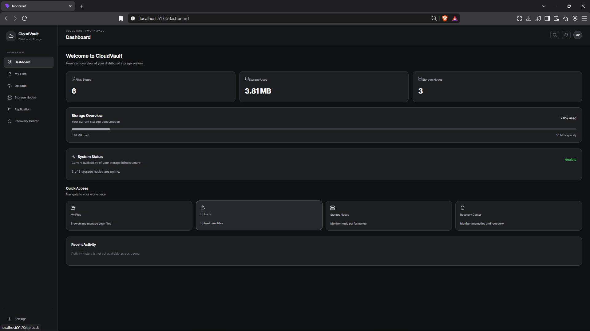
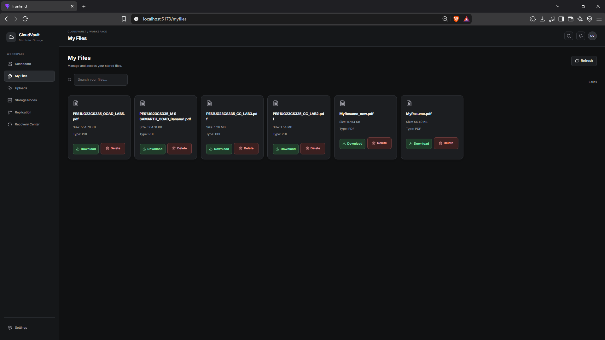
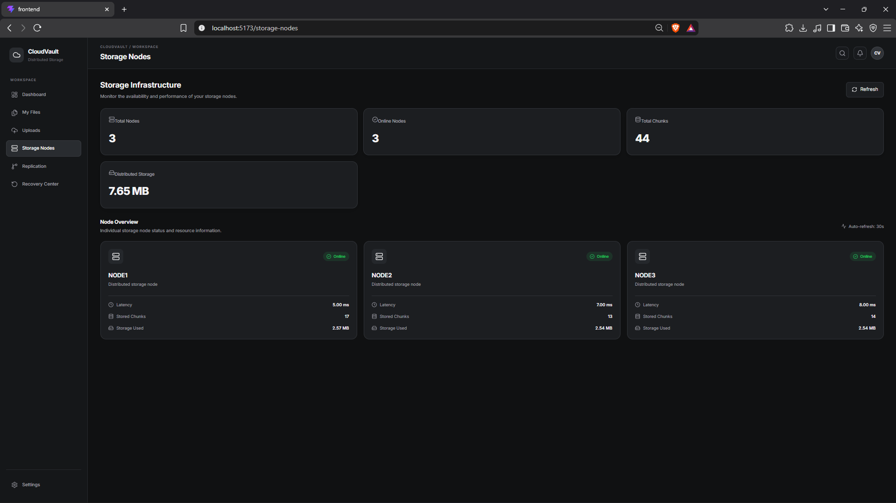
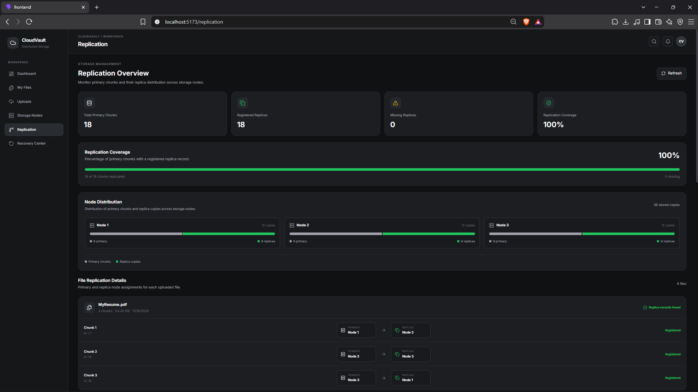
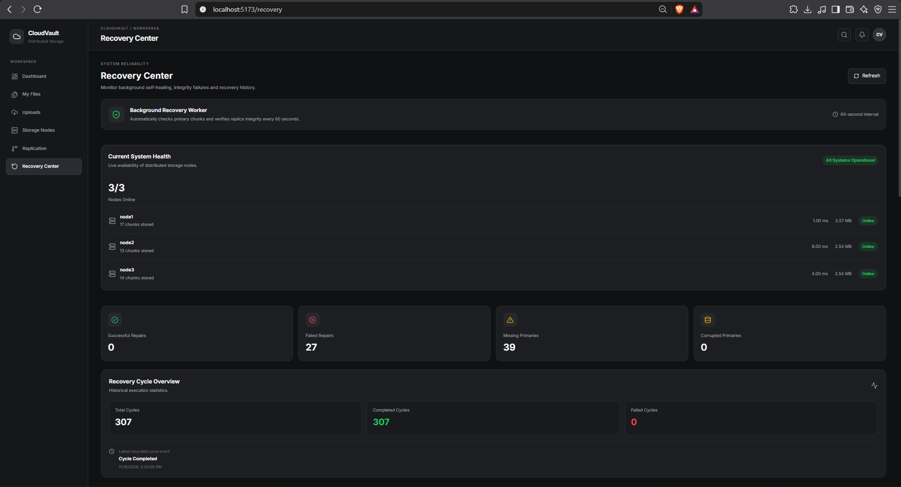

# CloudVault AI – Distributed Cloud Storage System

A fault-tolerant distributed file storage platform built using React, Node.js, Express.js, MySQL and Docker. CloudVault AI distributes file chunks across multiple storage nodes, maintains replica copies, monitors node health and automatically recovers unavailable or corrupted chunks.

## Key Features

- **JWT Authentication:** Secure user registration, login and protected routes.
- **Distributed File Storage:** Splits uploaded files into chunks and distributes them across multiple storage nodes.
- **Chunk Replication:** Maintains replica copies across different storage nodes for fault tolerance.
- **Fault Tolerance:** Supports continued file retrieval when a primary storage node or chunk becomes unavailable.
- **Replica-Based Recovery:** Retrieves and verifies replica data to recover unavailable chunks.
- **Automatic Self-Healing:** Background recovery worker checks chunk integrity and repairs damaged or missing primary chunks.
- **Data Integrity:** SHA-256 checksum verification to detect corrupted chunks.
- **Storage Monitoring:** Tracks node availability, latency, chunk count and storage usage.
- **Replication Monitoring:** Displays chunk distribution, replica records and replication coverage.
- **Recovery Center:** Provides recovery statistics, execution history and recorded failure events.
- **File Management:** Upload, download, search and delete stored files.
- **Multiple File Uploads:** Supports selecting and uploading multiple files through the frontend.

## Technology Stack

| Component | Technologies |
|---|---|
| Frontend | React, JavaScript, Axios, CSS |
| Backend | Node.js, Express.js |
| Database | MySQL |
| Authentication | JWT, bcrypt |
| Storage Infrastructure | Docker, Multiple Storage Nodes |
| Data Integrity | SHA-256 |
| API Communication | REST APIs |
| Development Tools | VS Code, Postman, Git, GitHub |

## System Architecture

```text
             React Frontend
                   |
                   v
          Node.js / Express API
                   |
          +--------+--------+
          |                 |
          v                 v
      MySQL Database    File Processing
          |                 |
          |             Chunk Creation
          |                 |
          |          +------+------+ 
          |          |      |      |
          |          v      v      v
          |        Node 1 Node 2 Node 3
          |          |      |      |
          |          +------+------+ 
          |                 |
          |           Replication
          |                 |
          +--------+--------+
                   |
             Monitoring
                   |
          Failure Detection
                   |
          Replica Verification
                   |
          Automatic Recovery
```

## File Processing Workflow

1. User uploads a file through the React frontend.
2. Backend processes the file and divides it into smaller chunks.
3. Chunks are distributed across the available storage nodes.
4. Replica copies are maintained on other nodes.
5. Chunk metadata, storage locations and checksums are maintained in MySQL.
6. During download, the backend retrieves and verifies the required chunks.
7. If a primary chunk is unavailable or corrupted, the system attempts replica-based retrieval and recovery.
8. Retrieved chunks are reconstructed into the original file.

## Fault Tolerance and Self-Healing

CloudVault implements two important recovery mechanisms:

**1. Download-Time Recovery**

When a primary chunk is unavailable during download:
- The system attempts to retrieve its replica.
- Replica integrity is verified using SHA-256.
- The file can be reconstructed using the retrieved data.
- The recovered chunk can be stored on another available node.

**2. Background Recovery**

A scheduled recovery worker:
- Periodically checks primary chunk availability.
- Verifies chunk integrity against stored checksums.
- Attempts recovery using healthy replicas.
- Repairs missing or corrupted primary chunks.
- Records recovery events for monitoring.

## Monitoring and Dashboard

The application provides dedicated interfaces for:

- Storage node health and availability.
- Distributed storage usage.
- Chunk and replica distribution.
- Replication coverage.
- Recovery statistics and historical events.
- File management and upload activity.

## Project Structure

```text
CloudVault_AI/
|
+-- backend/
|   +-- config/
|   +-- controllers/
|   +-- middleware/
|   +-- routes/
|   +-- services/
|   +-- server.js
|
+-- frontend/
|   +-- src/
|       +-- components/
|       +-- pages/
|       +-- services/
|
+-- README.md
```

## Future Improvements

- Advanced access control and file-sharing permissions.
- More detailed recovery analytics.
- Scalable storage-node management.
- Improved monitoring and alerting.
- Cloud deployment and production-grade orchestration.

## Application Screenshots

### Dashboard


### My Files


### Upload Management


### Storage Nodes


### Recovery Center


### Storage Nodes

Before running the project, create the following folders inside the backend directory:

```text
storage/
├ node1/
├ node2/
└ node3/
```

These folders simulate distributed storage nodes used for chunk replication and recovery.


## Author

**Samarth M S**


